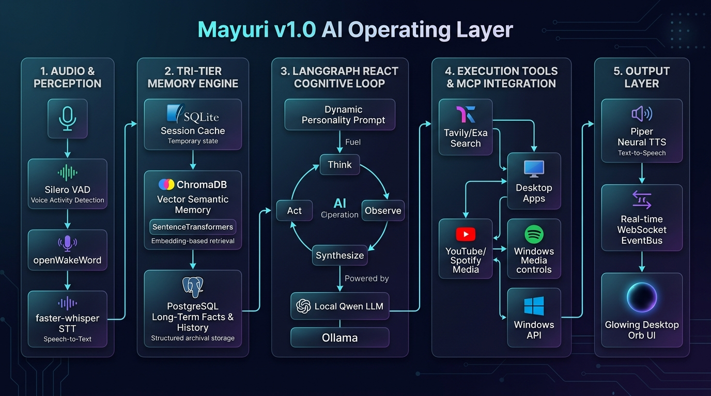

# Mayuri v1.0 — Local-First AI Operating Layer for Windows

<div align="center">



**An always-listening, privacy-first, local cognitive operating layer for Windows.**  
*Combines an ultra-low-power wake engine, tri-tier memory hierarchy, ReAct cognitive reasoning loop, and full Windows OS integration.*

[](https://github.com/AmanSah17/Mayuri_agent)
[](https://www.python.org/)
[](https://ollama.ai/)
[](https://langchain-ai.github.io/langgraph/)
[](https://github.com/AmanSah17/Mayuri_agent)
[](https://github.com/AmanSah17/Mayuri_agent)

</div>

---

## 📑 Table of Contents

- [Overview](#overview)
- [How the LLM Thinks, Reasons, and Uses the Pipeline](#how-the-llm-thinks-reasons-and-uses-the-pipeline)
  - [1. Perception & Audio Pipeline](#1-perception--audio-pipeline)
  - [2. Tri-Tier Cognitive Memory System](#2-tri-tier-cognitive-memory-system)
  - [3. Dynamic Personality & Fact Grounding](#3-dynamic-personality--fact-grounding)
  - [4. The LangGraph ReAct Cognitive Loop](#4-the-langgraph-react-cognitive-loop)
  - [5. Resilient Tool Execution & MCP Integration](#5-resilient-tool-execution--mcp-integration)
  - [6. Neural Voice Synthesis & Full-Duplex Control](#6-neural-voice-synthesis--full-duplex-control)
- [Running Mayuri as an Always-Running Windows Service](#running-mayuri-as-an-always-running-windows-service)
  - [Why Standard Windows Services (Session 0) Differ for Voice Assistants](#why-standard-windows-services-session-0-differ-for-voice-assistants)
  - [Method 1: Windows Task Scheduler (Recommended)](#method-1-windows-task-scheduler-recommended)
  - [Method 2: Non-Sucking Service Manager (NSSM)](#method-2-non-sucking-service-manager-nssm)
  - [Method 3: Windows Startup Registry](#method-3-windows-startup-registry)
  - [One-Click Start & Stop Scripts](#one-click-start--stop-scripts)
- [Configuration Reference (`.env`)](#configuration-reference-env)
- [Project Layout](#project-layout)
- [Quick Start Guide](#quick-start-guide)
- [Extensibility & Roadmap (Building on v1.0)](#extensibility--roadmap-building-on-v10)

---

## Overview

**Mayuri** is an intelligent desktop operating layer designed to live natively on Windows. Unlike cloud-tethered voice assistants, Mayuri runs **100% locally on your machine**:
- **Zero Cloud Latency & Total Privacy**: Audio streams, reasoning traces, personal memories, and tool executions never leave your hardware.
- **Ultra-Low Idle Footprint**: An always-on, tiny wake model (`openWakeWord`) and voice detector (`Silero VAD`) monitor the microphone, while heavy LLM neural weights (`Ollama / Qwen2.5`) stay suspended until invoked.
- **Deep Windows Operating System Control**: Seamlessly launches desktop applications, opens websites, controls media (YouTube, Spotify), performs system tasks, and executes neural and real-time web searches.
- **Persistent Personal Memory**: Remembers who you are, tracks facts across sessions, and recalls relevant conversational history from past threads.

---

## How the LLM Thinks, Reasons, and Uses the Pipeline

Mayuri's cognitive architecture bridges raw audio signals into structured intent, cross-session memory recall, ReAct reasoning, and deterministic tool execution.

```
                      ┌──────────────────────────────────────────┐
                      │        1. AUDIO & PERCEPTION             │
                      │  Mic → Silero VAD → openWakeWord / STT   │
                      └────────────────────┬─────────────────────┘
                                           │ User Utterance
                                           ▼
                      ┌──────────────────────────────────────────┐
                      │       2. TRI-TIER MEMORY RETRIEVAL       │
                      │  • SQLite: Active turn cache             │
                      │  • ChromaDB: Cross-thread vector context │
                      │  • PostgreSQL: Episodic facts & history  │
                      └────────────────────┬─────────────────────┘
                                           │ Enriched Context & Facts
                                           ▼
                      ┌──────────────────────────────────────────┐
                      │      3. DYNAMIC PERSONALITY PROMPT       │
                      │  Humor (0→1) | Verbosity | Spoken Rules  │
                      └────────────────────┬─────────────────────┘
                                           │
                                           ▼
               ┌────────────────────────────────────────────────────────┐
               │         4. LANGGRAPH ReAct REASONING CYCLE             │
               │                                                        │
               │   ┌────────┐  Tool Calls  ┌────────┐  Tool Result      │
               │   │ Think  │─────────────▶│  Act   │─────────────┐     │
               │   └────────┘              └────────┘             │     │
               │        ▲                                         │     │
               │        │               ┌─────────┐               │     │
               │        └───────────────│ Observe │◀──────────────┘     │
               │                        └─────────┘                     │
               │                             │ No more tools            │
               │                             ▼                          │
               │                      ┌─────────────┐                   │
               │                      │ Synthesize  │                   │
               │                      └─────────────┘                   │
               └───────────────────────────┬────────────────────────────┘
                                           │ Final Spoken Text
                                           ▼
                      ┌──────────────────────────────────────────┐
                      │            5. OUTPUT & DISPATCH          │
                      │  • Piper Neural TTS (Spoken response)    │
                      │  • WebSocket EventBus (Real-time Orb UI) │
                      │  • Memory Writeback (PG + Vector store)  │
                      └──────────────────────────────────────────┘
```

### 1. Perception & Audio Pipeline
1. **Continuous Capture**: A single unified 16kHz mono audio stream is captured via WASAPI (`sounddevice`).
2. **Silero VAD**: Evaluates 512-sample audio chunks every 32ms. Only audio with speech probability $> 0.5$ triggers processing, preventing background noise from waking the agent.
3. **Dual Wake Detection**:
   - **Wake Word Detection**: An ONNX-accelerated `openWakeWord` engine listens for `"Mayuri"` or `"Hey Mayuri"`.
   - **Conversational Continuity (Sliding Window)**: Once Mayuri responds, she remains in an active listening state for **45 seconds**. Follow-up questions do **not** require repeating the wake word.
4. **faster-whisper STT**: Transcribes the speech using local CTranslate2 INT8/FP16 weights. The wake-word stripper removes invocation prefixes (e.g. `"Mayuri, search Amazon for laptops"` $\to$ `"search Amazon for laptops"`).

### 2. Tri-Tier Cognitive Memory System
Unlike standard chatbots that forget past sessions upon restart, Mayuri incorporates a three-layer memory hierarchy:

| Memory Tier | Storage Backend | Purpose | Persistence |
|---|---|---|---|
| **Tier 1: Working Memory** | SQLite + LangGraph State | Immediate session state, active messages, turn scratchpad | Process lifetime & quick restarts |
| **Tier 2: Compressed Semantic Memory** | ChromaDB + `all-MiniLM-L6-v2` | Cross-thread semantic vector search; retrieves concepts spoken in past conversations | Permanent across reboots |
| **Tier 3: Episodic Knowledge Store** | PostgreSQL (asyncpg / SQLAlchemy) | Full historical transcript archive, structured `user_facts`, dynamic personality settings | Permanent across reboots |

- **Cross-Thread Recall**: Before the LLM generates a single token, `VectorConversationMemory.get_compressed_context(query)` searches vector embeddings across all past conversations and injects relevant summaries into the system prompt.

### 3. Dynamic Personality & Fact Grounding
Mayuri builds her system prompt dynamically on every turn:
- **Humor Level (`humor_level`)**: Scales from `0.0` (serious, purely objective) to `0.5` (friendly, dry wit) to `0.8+` (playful banter, clever observations, affectionate teasing).
- **Verbosity (`verbosity`)**: Calibrated for voice. Answers default to 1–3 concise sentences without markdown formatting, bullet points, or code blocks that would sound unnatural when read aloud by TTS.
- **Grounding Facts**: User preferences, identity, and hardware setup stored in PostgreSQL are formatted directly into the context (e.g., `"Things you know about Aman"`).

### 4. The LangGraph ReAct Cognitive Loop
Mayuri's decision engine is structured as a compiled LangGraph `StateGraph`:
1. **`llm_node` (Think)**: The local LLM (e.g., `qwen2.5:3b` via Ollama) processes the conversation history, user facts, and recalled memories. It determines whether the request requires tool intervention or a direct answer.
2. **`should_use_tools` (Route)**: Conditional router inspecting `response.tool_calls`.
   - If tools are requested $\to$ routes to `tools`.
   - If no tools are requested $\to$ routes to `respond_node`.
3. **`ToolNode` (Act & Observe)**: Executes structured tool calls. The outputs are appended as `ToolMessage` instances and fed directly back into `llm_node` so the LLM can observe the results and plan its next step.
4. **`respond_node` (Synthesize)**: Extracts the final spoken response, dispatches the text to the UI, and prepares the turn for memory persistence.

### 5. Resilient Tool Execution & MCP Integration
Mayuri uses structured tool calling (no arbitrary `exec()`). All tools are hardened with automated fallback:
- **Search Resilience**: `tavily_search` handles real-time web facts, news, and prices. If the Tavily API is unreachable or rate-limited, it **automatically bypasses to `exa_search`** (neural semantic search) with zero hallucination.
- **Windows System Control**:
  - `open_app`: Launches desktop applications (Chrome, Notepad, Spotify, VS Code, Calculator, etc.).
  - `open_browser`: Navigates to URLs or queries in the user's default browser.
  - `play_music`: Automatically searches and plays tracks or artists on YouTube or Spotify.
  - `calculate`: Safe mathematical expression evaluator.
  - `get_datetime`: Accurate current time and date in IST.

### 6. Neural Voice Synthesis & Full-Duplex Control
- **Piper Neural TTS**: High-speed, local neural speech synthesis generating natural voice output with sub-second latency.
- **Echo Suppression Lock**: During TTS speech synthesis (`self._is_speaking = True`), the microphone capture engine automatically mutes audio ingestion to eliminate acoustic feedback loops.
- **Real-Time UI EventBus**: A WebSocket stream pushes assistant states (`thinking`, `speaking`, `idle`), transcribed text, and real-time tool calls to the glowing desktop orb UI.

---

## Running Mayuri as an Always-Running Windows Service

To have Mayuri continuously available on your system, you can run it as an always-on Windows service.

### Why Standard Windows Services (Session 0) Differ for Voice Assistants
Windows Services registered in `services.msc` run in **Session 0** (isolated service session). However, voice assistants require:
1. **Active Audio Input/Output**: Windows Core Audio (WASAPI / microphone & speaker) is blocked in Session 0.
2. **Interactive Desktop Access**: Launching browser windows, media players, or GUI apps requires the interactive user session (Session 1+).

Therefore, Mayuri provides **three battle-tested deployment methods**:

---

### Method 1: Windows Task Scheduler (Recommended)
This is the recommended production approach for voice and desktop AI assistants. It runs Mayuri with highest privileges under your active user session, starts automatically on logon, restarts automatically if it ever crashes, and executes silently in the background.

To install:
```powershell
# Run PowerShell as Administrator (or standard user)
python scripts/setup_windows_service.py --task
```

**What this configures:**
- **Trigger**: At Windows user log on (`ONLOGON`).
- **Silent Launcher**: Executes `scripts/run_background.vbs` via `wscript.exe` with zero terminal popups.
- **Microphone & Speaker**: Full WASAPI access in the logged-in session.
- **Auto-Restart**: Windows Task Scheduler automatically restarts the process if interrupted.

To verify or start immediately:
```powershell
schtasks /run /tn "MayuriAI_Service"
```

---

### Method 2: Non-Sucking Service Manager (NSSM)
If your organization requires management via Windows Service Control Manager (`services.msc`), you can use **NSSM**:

1. Download NSSM from [nssm.cc/download](https://nssm.cc/download) and place `nssm.exe` in your `PATH`.
2. Open an **Administrator PowerShell** and configure:
```powershell
# 1. Install service pointing to Mayuri
nssm install MayuriAI "D:\CUDA_ENV\CUDA_ENV\Scripts\python.exe" "-m mayuri.main"

# 2. Set working directory
nssm set MayuriAI AppDirectory "D:\CUDA_ENV\Mayuri"

# 3. Configure log redirection
nssm set MayuriAI AppStdout "D:\CUDA_ENV\Mayuri\logs\nssm_stdout.log"
nssm set MayuriAI AppStderr "D:\CUDA_ENV\Mayuri\logs\nssm_stderr.log"

# 4. Enable auto-start and auto-restart
nssm set MayuriAI Start SERVICE_AUTO_START
nssm set MayuriAI AppRestartDelay 5000

# 5. Set user account (REQUIRED for microphone & desktop app access):
nssm set MayuriAI ObjectName ".\YOUR_WINDOWS_USERNAME" "YOUR_WINDOWS_PASSWORD"

# 6. Start service
nssm start MayuriAI
```

---

### Method 3: Windows Startup Registry
For a lightweight startup entry that launches on login without administrative rights:
```powershell
python scripts/setup_windows_service.py --runkey
```

### Checking Status & Uninstalling
```powershell
# Check whether Mayuri service/process is currently running
python scripts/setup_windows_service.py --status

# Remove startup and Task Scheduler entries
python scripts/setup_windows_service.py --uninstall
```

### One-Click Start & Stop Scripts
Convenience scripts are provided in the `scripts/` directory:
- **`scripts/start_service.bat`**: Starts Mayuri silently in the background without opening a terminal window.
- **`scripts/stop_service.bat`**: Gracefully terminates any background Mayuri instances.

---

## Configuration Reference (`.env`)

All parameters are managed via Pydantic settings in `mayuri/config.py`:

```dotenv
# ── Core Ollama LLM ──────────────────────────────────────────────────────────
OLLAMA_BASE_URL=http://localhost:11434
OLLAMA_MODEL=qwen2.5:3b

# ── Tri-Tier Database Configuration ──────────────────────────────────────────
# PostgreSQL (Episodic memory, facts, personality calibration)
POSTGRES_USER=postgres
POSTGRES_PASSWORD=your_password
POSTGRES_DB=mayuri
POSTGRES_HOST=localhost
POSTGRES_PORT=5432

# SQLite (Session working memory cache)
MEMORY_DB_PATH=data/memory.db

# ChromaDB (Compressed semantic cross-thread memory)
VECTOR_STORE_DIR=data/chromadb
EMBEDDING_MODEL_NAME=all-MiniLM-L6-v2

# ── Search & Reasoning APIs ──────────────────────────────────────────────────
TAVILY_API_KEY=tvly-your-tavily-key
EXA_API_KEY=your-exa-api-key

# ── Audio & Speech Engine ────────────────────────────────────────────────────
VAD_THRESHOLD=0.5
WAKE_WORD_THRESHOLD=0.5
PIPER_MODEL_PATH=models/piper/en_US-lessac-medium.onnx

# ── API & Desktop UI ─────────────────────────────────────────────────────────
API_HOST=127.0.0.1
API_PORT=8000
API_WS_PATH=/ws
LOG_LEVEL=INFO
```

---

## Project Layout

```
mayuri/
├── docs/
│   └── images/
│       └── mayuri_v1_architecture.jpg  # Architecture infographic (v1.0)
├── mayuri/                             # Core Python Package
│   ├── main.py                         # Top-level launcher & service supervisor
│   ├── config.py                       # Pydantic settings & environment manager
│   ├── logging_setup.py                # Loguru multi-sink configuration
│   ├── agent/                          # Cognitive Decision Engine
│   │   ├── graph.py                    # LangGraph StateGraph ReAct loop
│   │   ├── nodes.py                    # Cognitive nodes (LLM, respond, tools)
│   │   ├── state.py                    # AgentState schema & PersonalityConfig
│   │   └── tools.py                    # Hardened tools (Tavily, Exa, Windows, Media)
│   ├── audio/                          # Full-Duplex Audio Engine
│   │   ├── capture.py                  # WASAPI microphone stream
│   │   ├── vad.py                      # Silero neural voice activity detection
│   │   └── pipeline.py                 # Continuous audio listener & conversation continuity
│   ├── wake/                           # Wake Word Engine
│   │   ├── detector.py                 # openWakeWord ONNX evaluator
│   │   └── service.py                  # Wake state management & sliding window
│   ├── stt/                            # Speech-to-Text
│   │   └── transcriber.py              # faster-whisper CTranslate2 transcriber
│   ├── tts/                            # Text-to-Speech
│   │   └── synthesizer.py              # Piper neural voice synthesizer
│   ├── memory/                         # Tri-Tier Memory System
│   │   ├── pg_models.py                # SQLAlchemy ORM models (facts, turns, personality)
│   │   ├── pg_store.py                 # Async PostgreSQL memory interface
│   │   ├── store.py                    # SQLite working memory cache
│   │   └── vector_store.py             # ChromaDB + SentenceTransformers cross-thread memory
│   ├── api/                            # Backend & EventBus
│   │   ├── server.py                   # FastAPI server & static file router
│   │   ├── routes/                     # REST routes (chat, status, memory)
│   │   └── ws/events.py                # Real-time WebSocket EventBus
│   └── ui/                             # Desktop Cyberpunk Orb UI
│       ├── index.html
│       ├── app.js                      # Real-time WebSocket event handler
│       └── style.css                   # Glassmorphic UI styling
├── scripts/                            # Operational & Service Scripts
│   ├── setup_windows_service.py        # Task Scheduler, NSSM, and Registry manager
│   ├── run_background.vbs              # Headless silent background launcher
│   ├── start_service.bat               # One-click start script
│   ├── stop_service.bat                # One-click stop script
│   └── install_models.py               # Model downloader (Piper, Silero, Whisper)
├── tests/                              # Comprehensive Verification Suite
│   ├── test_qwen_pipeline.py           # End-to-end Qwen + LangGraph test
│   ├── test_frontend_realtime.py       # WebSocket streaming & cross-thread memory test
│   ├── test_memory.py                  # Memory store verification
│   └── test_stt.py                     # STT and wake-word stripping test
├── pyproject.toml
└── README.md
```

---

## Quick Start Guide

### 1. Prerequisites
- **Windows 10 / 11** (x64)
- **Python 3.11+**
- **Ollama** installed with target model:
  ```powershell
  ollama pull qwen2.5:3b
  ```
- **PostgreSQL** installed and running locally with database `mayuri`.

### 2. Installation
```powershell
# Clone the repository
git clone git@github.com:AmanSah17/Mayuri_agent.git
cd Mayuri_agent

# Activate virtual environment
.venv\Scripts\Activate.ps1

# Install package and dependencies
pip install -e ".[dev]"

# Download required model weights (Piper voice, Whisper, Silero VAD)
python scripts/install_models.py
```

### 3. Run Interactively
```powershell
python -m mayuri.main
```
Access the desktop UI at `http://localhost:8000/ui/`.

### 4. Run Tests
```powershell
python -m pytest tests/test_qwen_pipeline.py -v
python -m pytest tests/test_frontend_realtime.py -v
```

---

## Extensibility & Roadmap (Building on v1.0)

Mayuri is built as an extensible foundation for next-generation local AI operating layers:

- **Phase 2 — Vision & Screen Awareness**: Adding local vision models (Qwen2-VL / Moondream) to observe active screen regions and provide contextual desktop assistance.
- **Phase 3 — Multi-Modal MCP Ecosystem**: Expanding Model Context Protocol (MCP) servers to interface with local file indexes, IDEs (VS Code), and smart home devices.
- **Phase 4 — Local Autonomous Task Execution**: Long-horizon task automation with human-in-the-loop confirmation modals for critical file or system modifications.

---

<div align="center">
Built with ❤️ for privacy, speed, and autonomy.
</div>
